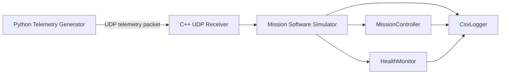

# UAV Mission Software Simulator

## 프로젝트 개요

UAV Mission Software Simulator는 C++17 기반 무인기 임무 제어, 상태 감시, 비정상 대응 절차를 학습하고 포트폴리오로 정리하기 위한 시뮬레이터 프로젝트이다. 실제 비행 제어기를 구현하는 것이 아니라, 임무 소프트웨어 관점에서 상태머신, 주기 태스크, Telemetry 수신, 이상 탐지, 이벤트 로깅 구조를 설계하고 단계적으로 구현하는 것을 목표로 한다.

이번 초기 버전은 프로젝트 구조, 설계 문서, CMake 빌드 뼈대, TODO 기반 소스 파일만 포함한다. 핵심 로직은 직접 구현할 수 있도록 의도적으로 비워 둔다.

## KAI 임무SW 직무와의 연관성

이 프로젝트는 항공기 및 무인기 임무SW 직무에서 중요하게 다루는 다음 역량을 보여주기 위한 목적으로 설계되었다.

- 임무 단계별 상태 관리와 상태 전이 설계
- Telemetry 기반 상태 감시 및 비정상 이벤트 판단
- 비정상 상황 발생 시 임무 복귀, 착륙, Abort 같은 대응 정책 정의
- RTOS 환경을 가정한 주기 태스크 구조 이해
- UDP 기반 외부 데이터 수신 구조 이해
- 로그 기반 임무 분석 및 시험 재현성 확보
- GoogleTest 기반 정상/비정상 시나리오 검증 계획 수립

## 기술스택

- C++17
- CMake
- GoogleTest 예정
- Python
- UDP Socket
- `std::thread`, `std::mutex`, `std::chrono`
- CSV logging

## 전체 아키텍처

Python Telemetry Generator가 UDP로 가상의 비행 데이터를 송신하고, C++ Mission Software Simulator가 이를 수신한다. 수신된 Telemetry는 MissionController와 HealthMonitor에 전달되어 임무 상태 전이와 비정상 이벤트 판단에 사용된다. CsvLogger는 임무 상태, 이벤트, Telemetry를 CSV 로그로 기록한다.



## 구현 예정 기능

- MissionController 기반 임무 상태머신 구현
- HealthMonitor 기반 배터리, 엔진, 통신, 고도, Telemetry 이상 탐지
- Python Telemetry Generator 시나리오 송신
- UDP Receiver 기반 Telemetry 수신 및 파싱
- PeriodicTask 기반 RTOS식 주기 태스크 모사
- CsvLogger 기반 임무 상태, 이벤트, Telemetry 기록
- GoogleTest 기반 정상/비정상 시나리오 검증

## 상태머신 개요

MissionController는 다음 상태를 관리한다.

- READY
- TAKEOFF
- EN_ROUTE
- MISSION_EXECUTE
- RETURN_HOME
- LANDING
- COMPLETE
- ABORT

정상 임무에서는 READY에서 시작해 TAKEOFF, EN_ROUTE, MISSION_EXECUTE, RETURN_HOME, LANDING, COMPLETE 순서로 진행한다. 비정상 이벤트가 발생하면 이벤트 정책에 따라 RETURN_HOME 또는 ABORT로 전이한다.

## 이벤트 탐지 정책

HealthMonitor는 Telemetry를 기반으로 다음 이벤트를 탐지할 예정이다.

- LOW_BATTERY
- ENGINE_OVERHEAT
- SIGNAL_WEAK
- TELEMETRY_TIMEOUT
- ALTITUDE_DEVIATION
- INVALID_TELEMETRY

각 이벤트의 세부 조건과 대응 상태는 [docs/event-policy.md](docs/event-policy.md)에 정리한다.

## 빌드 방법

```bash
cmake -S . -B build
cmake --build build
```

실행:

```bash
./build/uav_mission_sw_simulator
```

## 테스트 실행 방법

현재 테스트 파일은 TODO 기반 스켈레톤만 포함한다. GoogleTest 연동 후 다음 형태로 실행할 예정이다.

```bash
cmake -S . -B build -DBUILD_TESTING=ON
cmake --build build
ctest --test-dir build
```

## 개발 로드맵

1. Telemetry 데이터 구조와 유효성 검증 기준 확정
2. MissionController 상태 전이 로직 구현
3. HealthMonitor 이벤트 탐지 로직 구현
4. UDP 수신 및 Telemetry 파싱 구현
5. CSV 로그 포맷 정의 및 기록 구현
6. PeriodicTask 기반 주기 실행 구조 구현
7. Python Telemetry Generator 시나리오 구현
8. GoogleTest 정상/비정상 시나리오 작성
9. 로그 샘플과 실행 결과를 README에 추가

## 이력서용 프로젝트 요약 문장

C++17 기반 UAV 임무SW 시뮬레이터를 설계하여 상태머신 기반 임무 제어, Telemetry 기반 상태 감시, 비정상 이벤트 대응 정책, UDP 데이터 수신, 주기 태스크 구조, CSV 로그 기록 및 GoogleTest 검증 시나리오를 포트폴리오 형태로 구성했다.
