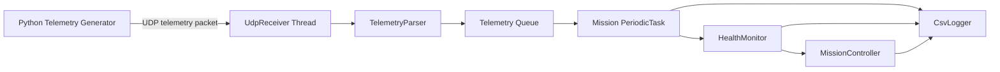

# UAV Mission Software Simulator

[](https://github.com/KimGyeongLock/UAV-Mission-Software-Simulator/actions/workflows/ci.yml)

## 프로젝트 개요

UAV Mission Software Simulator는 C++17 기반 무인기 임무 제어, 상태 감시, 비정상 대응 절차를 학습하고 포트폴리오로 정리하기 위한 시뮬레이터 프로젝트이다. 실제 비행 제어기를 구현하는 것이 아니라, 임무 소프트웨어 관점에서 상태머신, 주기 태스크, Telemetry 수신, 이상 탐지, 이벤트 로깅 구조를 설계하고 단계적으로 구현하는 것을 목표로 한다.

현재 버전은 상태머신, Telemetry 이벤트 탐지, UDP 수신 thread, mutex 보호 Telemetry queue, Python Telemetry 송신, random/fault injection 기반 시험 데이터 생성, CSV 로그 기록, 주기 태스크 실행, timeout 기반 Abort 처리, mission_config.json 기반 임계값 설정, GoogleTest 검증까지 포함한 1차 동작 가능한 임무SW 시뮬레이터이다.

## KAI 임무SW 직무와의 연관성

이 프로젝트는 항공기 및 무인기 임무SW 직무에서 중요하게 다루는 다음 역량을 보여주기 위한 목적으로 설계되었다.

- 임무 단계별 상태 관리와 상태 전이 설계
- Telemetry 기반 상태 감시 및 비정상 이벤트 판단
- 비정상 상황 발생 시 임무 복귀, 착륙, Abort 같은 대응 정책 정의
- RTOS 환경을 가정한 주기 태스크 구조 이해
- UDP 기반 외부 데이터 수신 구조 이해
- 로그 기반 임무 분석 및 시험 재현성 확보
- GoogleTest 기반 정상/비정상 시나리오 검증

## 기술스택

- C++17
- CMake
- GoogleTest
- Python
- UDP Socket
- `std::thread`, `std::mutex`, `std::chrono`
- CSV logging

## 전체 아키텍처

Python Telemetry Generator가 UDP로 가상의 비행 데이터를 송신하고, C++ Mission Software Simulator가 이를 수신한다. UdpReceiver는 별도 receiver thread에서 UDP payload를 수신하고, TelemetryParser는 문자열 payload를 Telemetry 구조체로 변환한다. 파싱된 Telemetry는 mutex로 보호되는 queue에 저장되며, Mission PeriodicTask는 정해진 주기마다 queue에서 Telemetry를 하나씩 꺼내 HealthMonitor와 MissionController에 전달한다. 이 구조를 통해 blocking UDP 수신이 임무 주기 태스크를 직접 지연시키지 않도록 분리했다. CsvLogger는 임무 상태, 이벤트, Telemetry를 CSV 로그로 기록한다.



## 구현 완료 기능

- MissionController 기반 임무 상태머신
- HealthMonitor 기반 배터리, 엔진, 통신, 고도, Telemetry 이상 탐지
- TelemetryParser 기반 UDP payload 문자열 파싱
- UdpReceiver 기반 UDP Telemetry 수신
- UDP 수신 thread와 Mission PeriodicTask 분리
- mutex 보호 Telemetry queue 기반 producer-consumer 구조
- Python Telemetry Generator 기반 시나리오 송신
- random stream 및 fault injection 기반 Telemetry 시험 모드
- PeriodicTask 기반 RTOS식 주기 태스크 모사
- CsvLogger 기반 임무 상태, 이벤트, Telemetry 기록
- Telemetry timeout 감지 및 ABORT 처리
- mission_config.json 기반 임무 및 이벤트 임계값 로딩
- GoogleTest 기반 핵심 임무 로직 검증


## Threading Model

시뮬레이터는 UDP 수신과 임무 판단을 분리한다.

| 실행 단위 | 역할 |
| --- | --- |
| Receiver Thread | UDP payload 수신, Telemetry 파싱, queue 저장 |
| Mission PeriodicTask | queue에서 Telemetry 소비, 이벤트 판단, 상태 전이, 로그 기록 |

Receiver Thread는 blocking UDP receive를 담당하고, Mission PeriodicTask는 설정된 주기로 임무 판단을 수행한다. 두 실행 단위는 mutex로 보호되는 Telemetry queue를 통해 데이터를 전달한다. queue가 가득 찬 경우 오래된 Telemetry를 버리고 최신 데이터를 보존하는 정책을 적용할 수 있다.

## 상태머신 개요

MissionController는 다음 상태를 관리한다.

- READY
- TAKEOFF
- EN_ROUTE
- MISSION_EXECUTE
- RETURN_HOME
- LANDING
- COMPLETE
- ABORT

정상 임무에서는 READY에서 시작해 TAKEOFF, EN_ROUTE, MISSION_EXECUTE, RETURN_HOME, LANDING, COMPLETE 순서로 진행한다. 비정상 이벤트가 발생하면 이벤트 정책에 따라 RETURN_HOME 또는 ABORT로 전이한다.

## 이벤트 탐지 정책

HealthMonitor는 Telemetry를 기반으로 다음 이벤트를 탐지한다.

- LOW_BATTERY
- ENGINE_OVERHEAT
- SIGNAL_WEAK
- TELEMETRY_TIMEOUT
- ALTITUDE_DEVIATION
- INVALID_TELEMETRY

각 이벤트의 세부 조건과 대응 상태는 [docs/event-policy.md](docs/event-policy.md)에 정리한다.

## 설정 파일

시뮬레이터는 `config/mission_config.json`에서 임무 파라미터, 이벤트 탐지 임계값, UDP 수신 포트, 로그 설정을 읽는다. 설정 파일을 사용하면 코드 수정 없이 임무 조건과 비정상 탐지 기준을 조정할 수 있다.

주요 설정값:

| 항목 | 설명 |
| --- | --- |
| `target_altitude_m` | 기준 목표 고도 |
| `low_battery_percent` | LOW_BATTERY 이벤트 임계값 |
| `engine_overheat_celsius` | ENGINE_OVERHEAT 이벤트 임계값 |
| `signal_weak_percent` | SIGNAL_WEAK 이벤트 임계값 |
| `telemetry_timeout_ms` | TELEMETRY_TIMEOUT 판단 시간 |
| `altitude_tolerance_m` | ALTITUDE_DEVIATION 허용 오차 |
| `listen_port` | C++ UdpReceiver가 바인딩할 UDP 포트 |

기본 설정 파일:

```text
config/mission_config.json
```

## 빌드 방법

```bash
cmake -S . -B build
cmake --build build
```

터미널 1에서 C++ 시뮬레이터 실행:

```bash
./build/uav_mission_sw_simulator
```

터미널 2에서 Python Telemetry Generator 실행:

```bash
python3 simulator/telemetry_generator.py --mode scenario --scenario low_battery
```

## 테스트 실행 방법

GoogleTest 기반 테스트는 MissionController, HealthMonitor, TelemetryParser의 핵심 동작을 검증한다.

```bash
cmake -S . -B build
cmake --build build
ctest --test-dir build
```

현재 테스트 결과:

```text
100% tests passed, 0 tests failed out of 15
```

## 지원 시나리오와 시험 모드

Python Telemetry Generator는 `--mode` 옵션으로 실행 방식을 선택한다.

### Scenario Mode

정해진 정상/비정상 시나리오를 재생한다.

```bash
python3 simulator/telemetry_generator.py --mode scenario --scenario normal
python3 simulator/telemetry_generator.py --mode scenario --scenario low_battery
python3 simulator/telemetry_generator.py --mode scenario --scenario engine_overheat
python3 simulator/telemetry_generator.py --mode scenario --scenario timeout
python3 simulator/telemetry_generator.py --mode scenario --scenario altitude_deviation
```

| 시나리오 | 설명 |
| --- | --- |
| `normal` | 정상 Telemetry 시퀀스 전송 |
| `low_battery` | 배터리 부족으로 RETURN_HOME 유도 |
| `engine_overheat` | 엔진 과열로 ABORT 유도 |
| `timeout` | Telemetry 전송 중단으로 timeout ABORT 유도 |
| `altitude_deviation` | 목표 고도 허용 오차 초과 이벤트 유도 |

### Random Stream Mode

정상 범위 내에서 배터리, 엔진 온도, 통신 신호, 고도를 랜덤하게 생성해 지속 전송한다.

```bash
python3 simulator/telemetry_generator.py --mode random --duration 10
```

### Fault Injection Mode

정상 Telemetry를 전송하다가 지정한 시점 이후 fault 값을 주입한다.

```bash
python3 simulator/telemetry_generator.py --mode fault --fault engine_overheat --after 3 --duration 8
```

지원 fault:

| Fault | 기대 결과 |
| --- | --- |
| `low_battery` | LOW_BATTERY 탐지 후 RETURN_HOME 전이 |
| `engine_overheat` | ENGINE_OVERHEAT 탐지 후 ABORT 전이 |
| `signal_weak` | SIGNAL_WEAK 이벤트 탐지 |
| `altitude_deviation` | ALTITUDE_DEVIATION 이벤트 탐지 |
| `invalid_telemetry` | INVALID_TELEMETRY 이벤트 탐지 |
| `timeout` | TELEMETRY_TIMEOUT 탐지 후 ABORT 전이 |

Engine overheat fault injection 실행 예시:

```text
tick=1 state=EN_ROUTE event=NONE battery=80
tick=2 state=MISSION_EXECUTE event=NONE battery=80
tick=3 state=RETURN_HOME event=NONE battery=80
tick=4 state=ABORT event=ENGINE_OVERHEAT battery=80
```

## 샘플 로그

시나리오별 실행 결과는 `docs/sample-logs/`에 CSV 파일로 정리한다.

| 시나리오 | 샘플 로그 |
| --- | --- |
| Low Battery Return | `docs/sample-logs/low_battery_mission_log.csv` |
| Engine Overheat Abort | `docs/sample-logs/engine_overheat_mission_log.csv` |
| Telemetry Timeout Abort | `docs/sample-logs/timeout_mission_log.csv` |

## 개발 로드맵

1. GoogleTest 시나리오 확대
2. 로그 샘플과 실행 결과 이미지 추가
3. README와 docs에 설계 의도 및 트러블슈팅 보강
4. UDP 수신 queue overflow 정책 테스트 추가

## 이력서용 프로젝트 요약 문장

C++17 기반 UAV 임무SW 시뮬레이터를 설계하고 구현하여 상태머신 기반 임무 제어, UDP Telemetry 수신 thread, mutex 기반 producer-consumer queue, 설정 파일 기반 상태 감시, fault injection 기반 비정상 이벤트 재현, timeout 기반 Abort 처리, 주기 태스크 구조, CSV 로그 기록 및 GoogleTest 검증을 수행했다.
