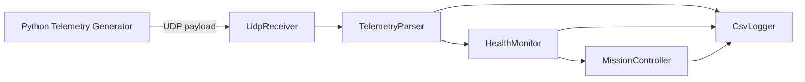

# Architecture

## 목적

UAV Mission Software Simulator는 무인기 임무SW의 핵심 흐름을 단순화해 학습하고 검증하기 위한 C++17 기반 시뮬레이터이다. 실제 비행 제어 알고리즘이 아니라, 임무 상태 관리, Telemetry 수신, 상태 감시, 이벤트 대응, 로그 기록 구조를 중심으로 설계한다.

## 전체 구성

## 주요 컴포넌트

| 컴포넌트 | 역할 | 구현 위치 |
| --- | --- | --- |
| Python Telemetry Generator | 정상/비정상 비행 데이터를 UDP로 송신 | `simulator/telemetry_generator.py` |
| UdpReceiver | UDP 패킷 수신 | `include/io/UdpReceiver.hpp`, `src/io/UdpReceiver.cpp` |
| TelemetryParser | UDP payload 문자열을 Telemetry 구조체로 변환 | `include/core/TelemetryParser.hpp`, `src/core/TelemetryParser.cpp` |
| MissionController | 임무 상태머신 관리 | `include/core/MissionController.hpp`, `src/core/MissionController.cpp` |
| HealthMonitor | Telemetry 기반 이벤트 탐지 | `include/core/HealthMonitor.hpp`, `src/core/HealthMonitor.cpp` |
| PeriodicTask | RTOS식 주기 태스크 구조 모사 | `include/scheduler/PeriodicTask.hpp`, `src/scheduler/PeriodicTask.cpp` |
| CsvLogger | 상태, 이벤트, Telemetry 로그 기록 | `include/io/CsvLogger.hpp`, `src/io/CsvLogger.cpp` |

## 데이터 흐름

1. Python Telemetry Generator가 시나리오별 가상 Telemetry를 생성한다.
2. Telemetry는 UDP 패킷으로 C++ 시뮬레이터에 전달된다.
3. UdpReceiver가 UDP payload 문자열을 수신한다.
4. TelemetryParser가 payload를 Telemetry 구조체로 변환한다.
5. HealthMonitor가 Telemetry를 검사해 이벤트를 생성한다.
6. MissionController가 이벤트와 현재 상태를 바탕으로 다음 임무 상태를 결정한다.
7. CsvLogger가 Telemetry, 이벤트, 상태 변화를 CSV 파일로 기록한다.

## 현재 구현 상태

- MissionController 정상/비정상 상태 전이 구현
- HealthMonitor 이벤트 탐지 및 Telemetry timeout 감지 구현
- UdpReceiver UDP 수신 구현
- TelemetryParser 문자열 payload 파싱 구현
- Python Telemetry Generator 시나리오 송신 구현
- CsvLogger CSV 기록 구현
- PeriodicTask 기반 주기 실행 구현
- GoogleTest 10개 테스트 통과

## 설계 원칙

- 실제 비행 제어가 아닌 임무SW 구조 이해에 집중한다.
- 핵심 로직은 상태머신과 이벤트 정책으로 분리한다.
- 테스트 가능한 순수 C++ 컴포넌트와 외부 I/O 컴포넌트를 구분한다.
- 각 이벤트의 탐지 조건과 대응 상태를 문서화해 구현 기준을 명확히 한다.
