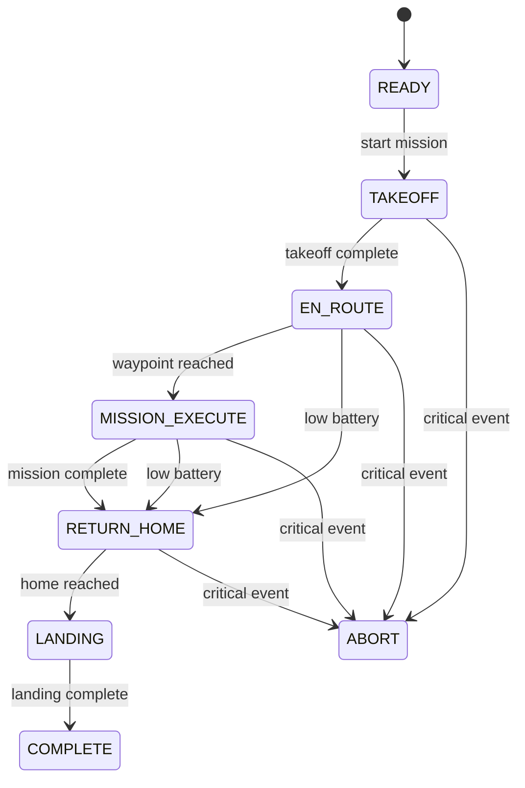

# State Machine

## MissionState 목록

| 상태 | 의미 |
| --- | --- |
| READY | 임무 시작 전 초기 대기 상태 |
| TAKEOFF | 이륙 진행 상태 |
| EN_ROUTE | 임무 지역으로 이동 중인 상태 |
| MISSION_EXECUTE | 지정 임무를 수행 중인 상태 |
| RETURN_HOME | 기지 또는 복귀 지점으로 복귀 중인 상태 |
| LANDING | 착륙 절차 수행 상태 |
| COMPLETE | 임무 정상 완료 상태 |
| ABORT | 치명적 이상으로 임무 중단 상태 |

## 상태 다이어그램

## 정상 전이

| 현재 상태 | 조건 | 다음 상태 |
| --- | --- | --- |
| READY | 임무 시작 명령 | TAKEOFF |
| TAKEOFF | 이륙 완료 | EN_ROUTE |
| EN_ROUTE | 임무 지점 도달 | MISSION_EXECUTE |
| MISSION_EXECUTE | 임무 수행 완료 | RETURN_HOME |
| RETURN_HOME | 복귀 지점 도달 | LANDING |
| LANDING | 착륙 완료 | COMPLETE |

## 비정상 전이

| 현재 상태 | 이벤트 | 다음 상태 | 비고 |
| --- | --- | --- | --- |
| EN_ROUTE | LOW_BATTERY | RETURN_HOME | 잔여 배터리가 낮지만 복귀 가능하다고 판단 |
| MISSION_EXECUTE | LOW_BATTERY | RETURN_HOME | 임무를 중단하고 복귀 |
| TAKEOFF | ENGINE_OVERHEAT | ABORT | 초기 단계 치명 고장 |
| EN_ROUTE | ENGINE_OVERHEAT | ABORT | 비행 안전을 위해 임무 중단 |
| MISSION_EXECUTE | TELEMETRY_TIMEOUT | ABORT | 상태 확인 불가 |
| RETURN_HOME | TELEMETRY_TIMEOUT | ABORT | 복귀 중 상태 확인 불가 |
| 모든 비완료 상태 | INVALID_TELEMETRY | 상태 유지 또는 ABORT | 구현 시 정책 확정 필요 |
| EN_ROUTE 또는 MISSION_EXECUTE | ALTITUDE_DEVIATION | 상태 유지 | Warning 로그 기록 예정 |
